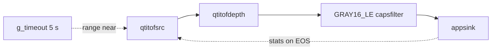

# gst-qimsdk-tof-depth

Sample app for the Arducam ToF camera on the Arduino VENTUNO Q using the standard GStreamer C API and the sample-app
utilities: live depth from `qtitofsrc → qtitofdepth` into an `appsink`, the distance at the image centre once per
second, a range-mode switch while the pipeline is PLAYING, and the source's controls and statistics read back.
Generated with the `qimsdk-gstreamer-app-builder` skill and reviewed (arducam-tof-ventuno RUN-0055, T5.5).

## Files

| File | Purpose |
|---|---|
| `main.c` | the app |
| `CMakeLists.txt` | build in the `gst-sample-apps` tree (skill template) |
| `README.md` | this file |

## Pipeline Flow

### Text Summary

`qtitofsrc` (range `far`, 300 groups) → `qtitofdepth` (calibration v1) → `capsfilter` `video/x-raw,format=GRAY16_LE,
width=240,height=180,framerate=30/1` → `appsink` (`new-sample`: centre distance per frame, printed every 30 frames;
`eos`: final `stats`). A main-loop timeout sets `range` = `near` on `qtitofsrc` after 5 s while PLAYING.

### Mermaid Diagram



## Placeholders to Fill

| Placeholder | Description |
|---|---|
| `CALIBRATION_FILE` (`#define` in `main.c`) | device-specific absolute path of the depth calibration key file; set to `/home/arduino/Downloads/arducam-tof-ventuno/calib/tof-depth-cal-v1.conf` on the project's board — change it for another user/workspace (C string literals do not expand `$HOME`) |

## Steps to Run

All files the app references (the calibration key file, and the `qtitof` plugin of this fork on `GST_PLUGIN_PATH`)
must be present on the device at their referenced paths before running.

```bash
# Copy the app to device
scp gst-qimsdk-tof-depth <user>@<device-ip>:~/

# SSH into device and run
ssh <user>@<device-ip>
chmod +x ~/gst-qimsdk-tof-depth
./gst-qimsdk-tof-depth
```

The ToF camera must be available: drivers loaded on the ToF boot entry (`arducam-tof-camss`), and the fork's plugin
found (`eval "$(~/Downloads/arducam-tof-ventuno/tools/imsdk-build.sh --env)"` on the project's board).

Output on the VENTUNO Q (RUN-0055 step 6, camera facing a surface ≈ 1.8 m away):

```text
module firmware 0x10002, device id 0x0030
t= 1.58 s  frame   30  range far   centre 1825 mm
...
t= 5.05 s  range set to near
t= 5.64 s  frame  150  range near  centre 1797 mm
...
EOS: stats, groups-pushed=(guint64)300, groups-incomplete=(guint64)1, frames-stray=(guint64)4, sequence-gaps=(guint64)0, groups-dropped-switch=(guint64)2, groups-dropped-start=(guint64)2, range-switches=(guint64)1;
received 300 depth frames, 29.81 frames/s (PTS), 0 without a valid centre
```

## Assumptions

- `qtitofsrc` / `qtitofdepth` are the elements of this fork's `gst-plugin-tof` (`-DENABLE_GST_PLUGIN_TOF=ON`); they
  are not in the skill's plugin catalog. Properties used: `range` (enum, mutable in PLAYING), `num-buffers`,
  `firmware-version`, `device-id`, `stats` (`qtitofsrc`); `calibration` (`qtitofdepth`).
- Without `calibration`, `qtitofdepth` outputs uncorrected, non-metric depth and posts a warning (printed by the
  utils' `warning_cb` with an "ERROR:" prefix).
- Near mode is unambiguous only up to 2.0 m (far: 4.0 m); a target beyond that wraps around.
- `groups-incomplete` may be 1: an incomplete group at stream start, before the first group is pushed.
- Built in the 1.8.1 fork tree; the `<gst/sampleapps/gst_sample_apps_utils.h>` include resolves through the utils
  library's in-tree `gst/sampleapps/` header copy. `json-glib-1.0` is required by the template, unused by the app.
  Subset build: `-DENABLE_GST_SAMPLE_APPS=ON -DGST_SAMPLE_APPS_ONLY=gst-qimsdk-tof-depth`.

## Build Instructions

- **QLI:** https://imsdkdocs.qualcomm.com/advanced/yocto-build#steps-to-build-custom-application
