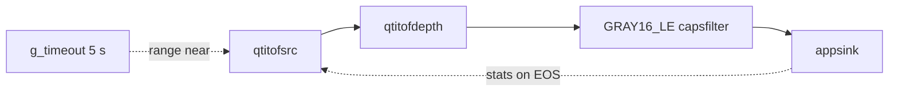

# gst-qimsdk-tof-depth

Sample app for the Arducam ToF camera (`gst-plugin-tof`) using the standard GStreamer C API and the sample-app
utilities: live depth from `qtitofsrc → qtitofdepth` into an `appsink`, the distance at the image centre once per
second, a range-mode switch while the pipeline is PLAYING, and the source's controls and statistics read back.
Generated with the `qimsdk-gstreamer-app-builder` skill and reviewed.

## Files

| File | Purpose |
|---|---|
| `main.c` | the app |
| `CMakeLists.txt` | build in the `gst-sample-apps` tree (skill template) |
| `README.md` | this file |

## Pipeline Flow

### Text Summary

`qtitofsrc` (range `far`, 300 groups) → `qtitofdepth` (default calibration) → `capsfilter` `video/x-raw,format=GRAY16_LE,
width=240,height=180,framerate=30/1` → `appsink` (`new-sample`: centre distance per frame, printed every 30 frames;
`eos`: final `stats`). A main-loop timeout sets `range` = `near` on `qtitofsrc` after 5 s while PLAYING.

### Mermaid Diagram



## Placeholders to Fill

| Placeholder | Description |
|---|---|
| (none) | `calibration` is left unset: `qtitofdepth` uses `$GST_TOF_CALIBRATION` or the default path it was built with (`TOF_DEFAULT_CALIBRATION`, see `gst-plugin-tof/README.md`) |

## Steps to Run

All files the app references (the depth calibration, and the `qtitof` plugin) must be present on the device at their
referenced paths before running.

```bash
# Copy the app to device
scp gst-qimsdk-tof-depth <user>@<device-ip>:~/

# SSH into device and run
ssh <user>@<device-ip>
chmod +x ~/gst-qimsdk-tof-depth
./gst-qimsdk-tof-depth
```

The ToF camera must be available: the CAMSS and `arducam-pivariety` drivers bound to it (see
`gst-plugin-tof/README.md`), and the `qtitof` plugin found by GStreamer.

Example output (Arduino VENTUNO Q, camera facing a surface ≈ 1.8 m away):

```text
module firmware 0x10002, device id 0x0030
t= 1.58 s  frame   30  range far   centre 1825 mm
...
t= 5.05 s  range set to near
t= 5.64 s  frame  150  range near  centre 1797 mm
...
EOS: stats, groups-pushed=(guint64)300, groups-incomplete=(guint64)1, frames-stray=(guint64)4, sequence-gaps=(guint64)0, groups-dropped-switch=(guint64)2, groups-dropped-start=(guint64)2, range-switches=(guint64)1;
received 300 depth frames, 29.81 frames/s (PTS), 0 without a valid centre
```

## Assumptions

- `qtitofsrc` / `qtitofdepth` are the elements of `gst-plugin-tof` (`-DENABLE_GST_PLUGIN_TOF=ON`); they
  are not in the skill's plugin catalog. Properties used: `range` (enum, mutable in PLAYING), `num-buffers`,
  `firmware-version`, `device-id`, `stats` (`qtitofsrc`).
- Without any calibration file `qtitofdepth` stops at start with an error naming the way out; `calibration=""` asks for
  uncalibrated (non-metric) depth explicitly.
- Near mode is unambiguous only up to 2.0 m (far: 4.0 m); a target beyond that wraps around.
- `groups-incomplete` may be 1: an incomplete group at stream start, before the first group is pushed.
- `<gst_sample_apps_utils.h>` comes from the `gstappsutils` library, as in the other sample apps. `json-glib-1.0` is
  required by the template, unused by the app.

## Build Instructions

- **QLI:** https://imsdkdocs.qualcomm.com/advanced/yocto-build#steps-to-build-custom-application
